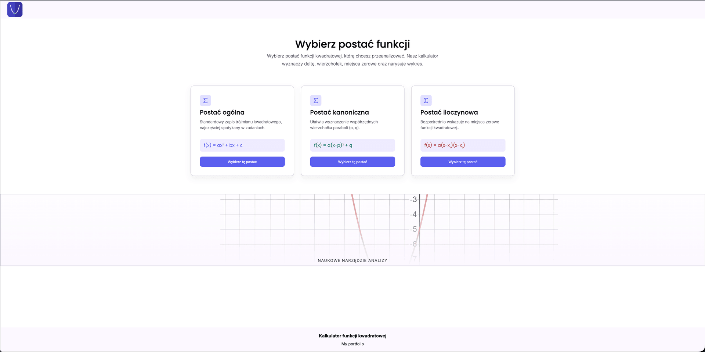
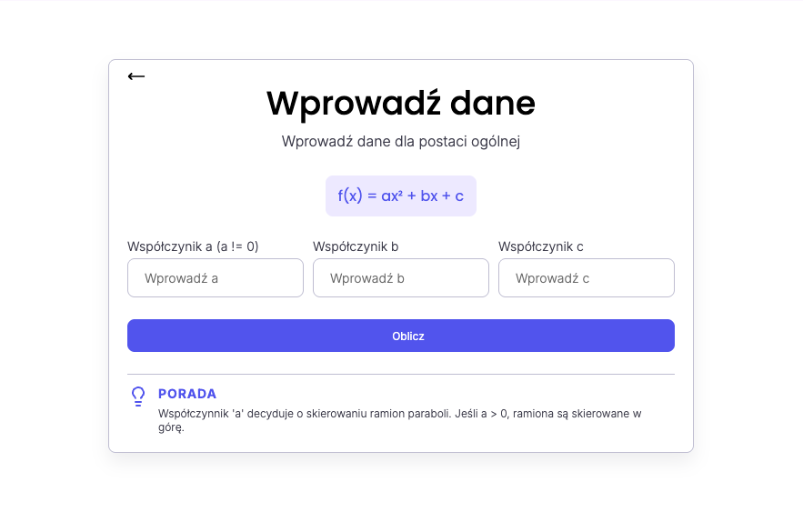
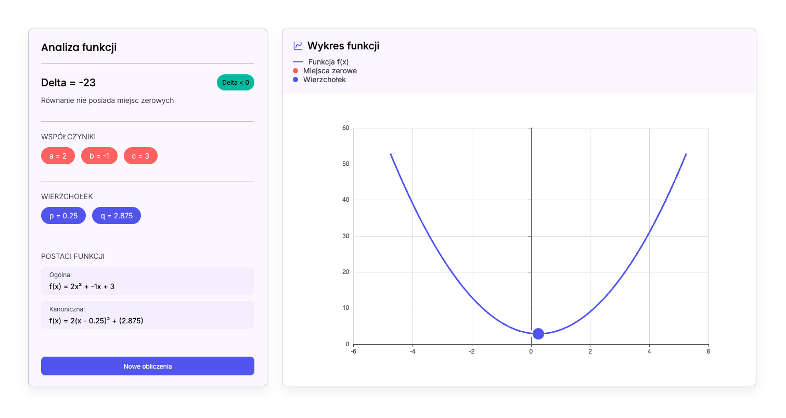
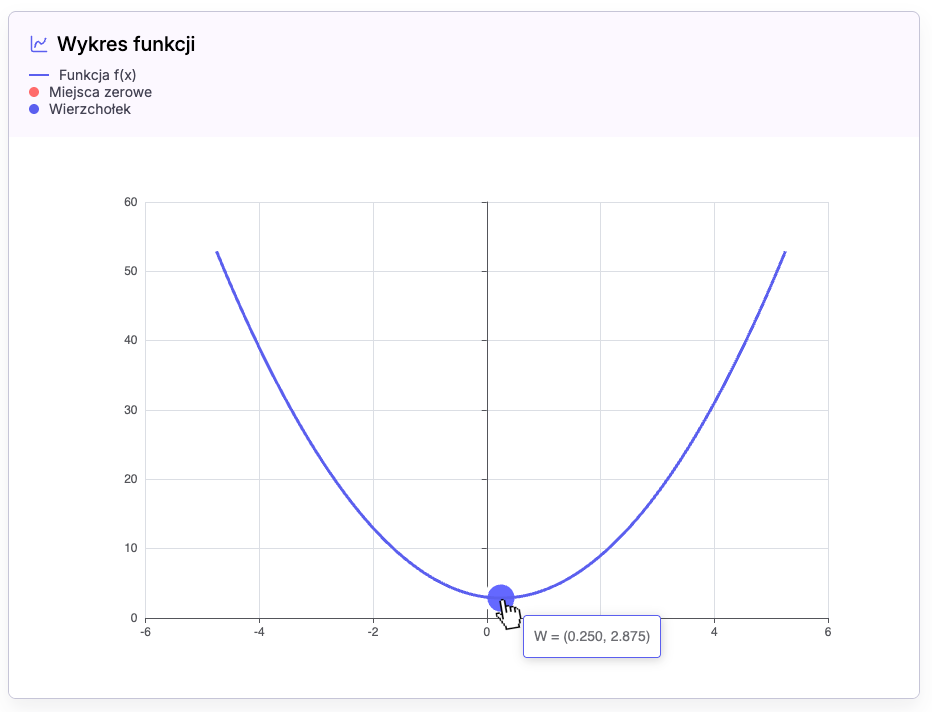

<h1>Quadratic Function Calculator · Angular</h1>

<p>
  
  
  
  
</p>

A calculator that analyses a quadratic function in any of its three forms (**general**, **vertex** or **factored**): it computes the discriminant, roots and vertex, converts between forms and plots the graph.

It's a rewrite of my earlier [React version](https://github.com/Matrix669/quadratic-function-calculator). I wanted to see what working with Angular is really like, on a project whose logic I already knew, so I could compare both approaches fairly. I also improved a few things along the way.



## Features

- **Three input forms:** general `ax² + bx + c`, vertex `a(x − p)² + q` and factored `a(x − x₁)(x − x₂)`
- **Full analysis:** discriminant (Δ), roots, vertex and the function rewritten in the other forms
- **Interactive graph:** the vertex and roots are marked as separate points, with tooltips showing their coordinates
- **Form validation** with hints, e.g. about the sign of coefficient `a`

<table>
  <tr>
    <td></td>
    <td></td>
  </tr>
  <tr>
    <td align="center"><sub>Entering coefficients</sub></td>
    <td align="center"><sub>Results and graph</sub></td>
  </tr>
</table>

## What changed compared to the React version

- **Modern Angular throughout:** fully standalone components, the **Signals API** (`signal`, `input`, `output`, `computed`) instead of NgModules, and the new control-flow syntax (`@if`, `@for`)
- **Chart.js → ngx-echarts:** a clearer graph with the vertex and roots marked separately, plus tooltips
- Better presentation of the results and a custom logo



## Tech stack

Angular 22 · TypeScript · Signals · ngx-echarts (ECharts) · ng-icons · SCSS · Vitest

## Running locally

```bash
npm install
npm start        # ng serve → http://localhost:4200
```

```bash
npm run build    # production build → dist/
npm test         # unit tests (Vitest)
```

---

<sub>More of my projects → <a href="https://maxtkaczyk.pl"><b>maxtkaczyk.pl</b></a></sub>
